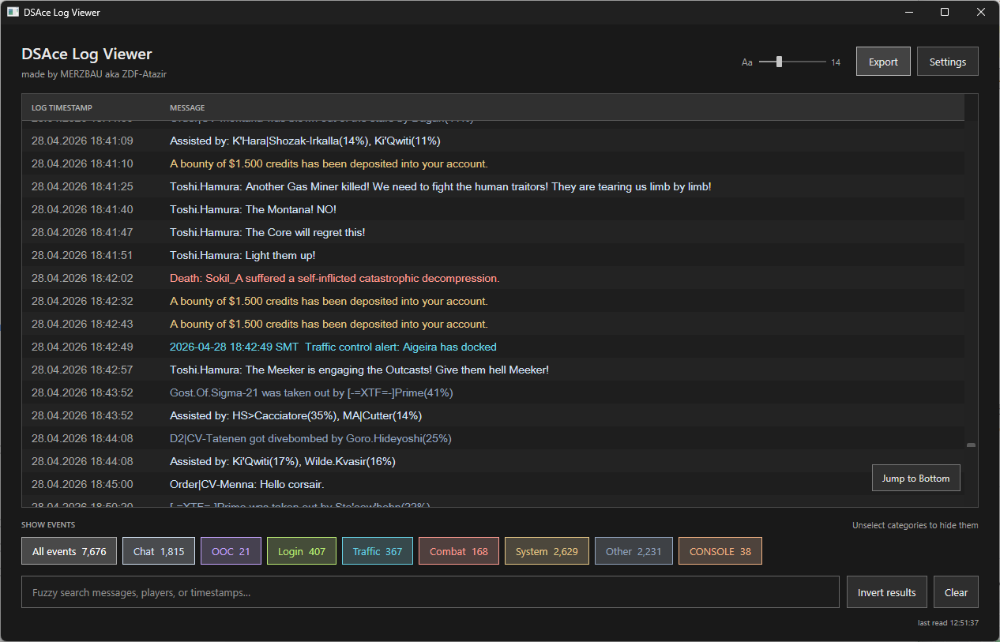

# DSAceViewer



A standalone Windows viewer for Discovery Freelancer's `DSAce.log`, with live
following, event filters, fuzzy search, word wrap and export.

[Download the latest release](https://github.com/Tanami/DSAceViewer/releases/latest).
Choose your log file in Settings if it is not found automatically.

Made by MERZBAU aka ZDF-Atazir.

## Build and test

Requires the .NET 10 SDK on Windows:

```powershell
./build.ps1
dotnet run --project tests/DSAceLogViewer.Tests -c Release
```

The build script supports `-Runtime win-arm64` and `-Runtime win-x86` as well.
Each local build places `DSAceLogViewer.exe` in `dist`.

The regression runner uses temporary synthetic logs to verify classification,
fuzzy matching, inversion, exports, saved settings, live appends, split text/BOMs,
file sharing, replacement, truncation, rotation and cancellation. Its WPF test
exercises the actual filter controls and follow state in-process without opening
a desktop window or changing user preferences. Optional arguments:

```powershell
dotnet run --project tests/DSAceLogViewer.Tests -c Release -- --render qa --log 'C:/path/to/DSAce.log'
```

`--render` writes synthetic-data desktop, compact and settings layout PNGs.
`--log` performs an additional read-only format check without copying user chat
into the repository. Build outputs, QA renders and real logs are not tracked.
